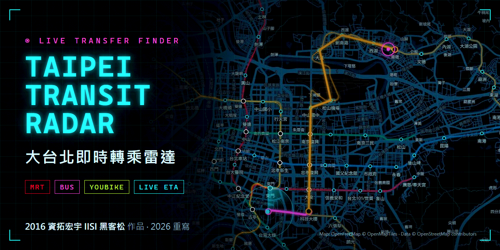
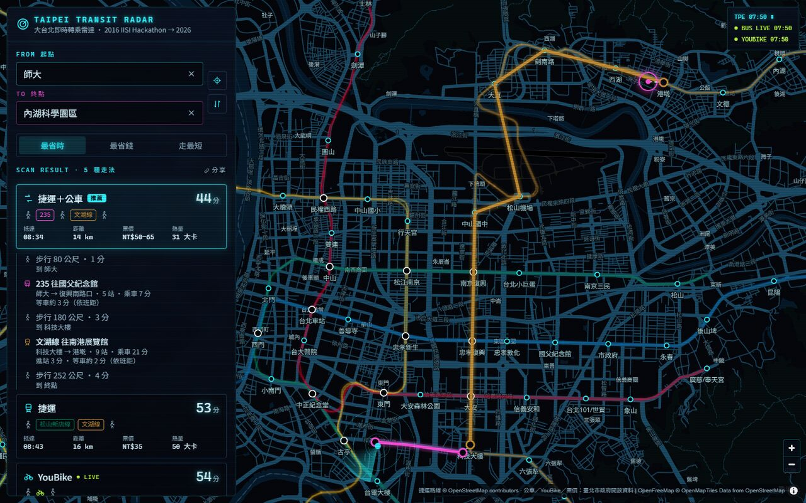
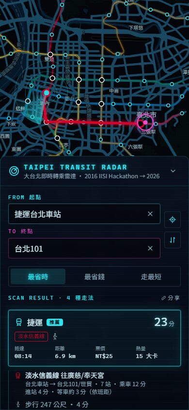
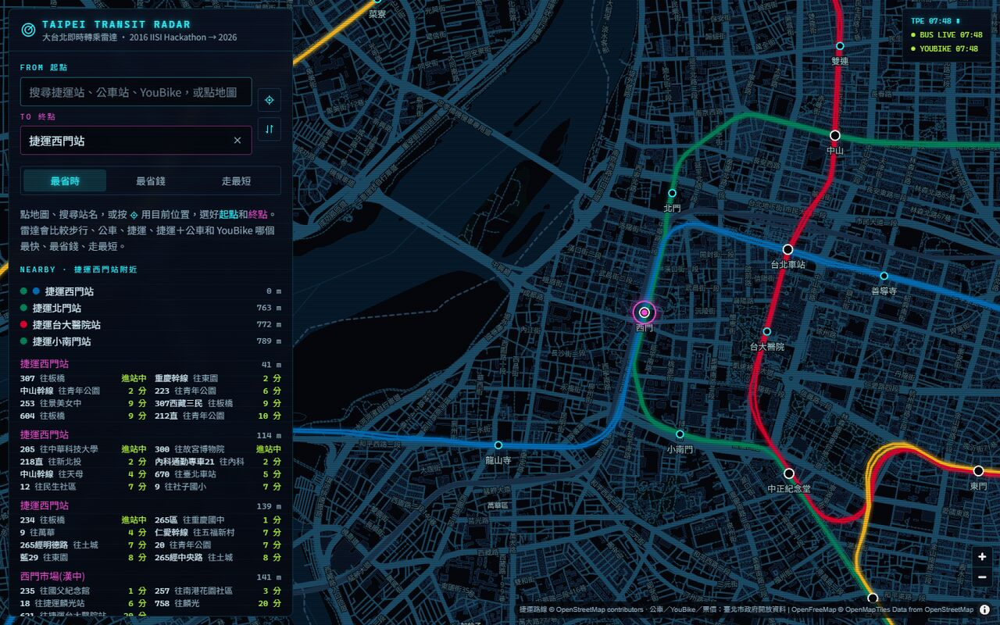
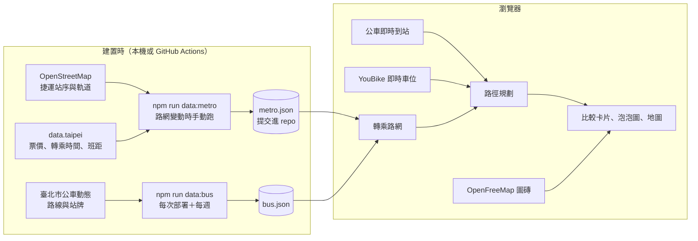

# Taipei Transit Radar · 大台北即時轉乘雷達



> 2016 年[資拓宏宇（IISI）黑客松](docs/2016-hackathon.md)第三隊的作品「最即時的大眾運輸比較系統」，2026 年用 React、Tailwind 和政府開放資料整個重寫。
> 感謝當年的隊友 [@impaulapple](https://github.com/impaulapple)：原始 repo 135 個 commit 中有 125 個是他寫的。

[](https://github.com/NatLee/taipei-transit-radar/actions/workflows/ci.yml)
[](https://github.com/NatLee/taipei-transit-radar/actions/workflows/deploy.yml)
[](LICENSE)


在大台北要從 A 到 B，該走路、搭公車、坐捷運，還是騎 YouBike？這個網頁在地圖上選好起點和終點，就會同時算出五種走法：步行、公車、捷運、捷運加公車、YouBike。每種走法都列出要搭哪幾線、等多久、幾點到、多遠、多少錢、消耗多少熱量，可以依「最省時／最省錢／走最短」排序。公車用即時到站資料估等車時間，YouBike 用即時車位挑借還車站。整個網站是靜態網頁，放在 GitHub Pages 上，不用註冊、不用金鑰，查詢可以直接用網址分享。

**線上版**：<https://natlee.github.io/taipei-transit-radar/>

## 畫面



| 手機版 | 附近的站和即時到站 |
|---|---|
|  |  |

## 能做什麼

- **選起點和終點**：搜尋捷運站、公車站、YouBike 站，或直接點地圖；也可以用目前位置當起點，會順便告訴你最近的捷運站。⇅ 按鈕對調起訖。
- **五種走法一起比**：每種走法都列出每一段怎麼走：走幾公尺、搭哪條線往哪裡、坐幾站、等車多久（標明是即時、依班距還是估計）。
- **排序和推薦**：最省時、最省錢、走最短，第一名標「推薦」。
- **泡泡比一比**：耗時、距離、花費各一排泡泡，面積和數值成正比。
- **附近資訊**：選定的地點附近有哪些捷運站、公車站（每條路線的即時到站時間）、YouBike 站（可借車輛、可還車位）。
- **分享**：網址會跟著查詢更新，例如 [`?from=BL12&to=25.03360,121.56480~台北101`](https://natlee.github.io/taipei-transit-radar/?from=BL12&to=25.03360,121.56480~%E5%8F%B0%E5%8C%97101)。
- **手機版**：面板在下方，可以收起來看地圖。系統設定「減少動態效果」時，雷達掃描等動畫會關掉。

## 資料從哪裡來



| 資料 | 來源 | 什麼時候抓 | 授權 |
|---|---|---|---|
| 捷運站序、軌道形狀 | OpenStreetMap（Overpass API） | 路網變動時手動 | ODbL，© OpenStreetMap contributors |
| 捷運票價和站間距離 | data.taipei 臺北捷運系統票價 | 同上 | 政府資料開放授權條款－第 1 版 |
| 捷運轉乘步行時間、班距 | data.taipei | 同上 | 政府資料開放授權條款－第 1 版 |
| 公車路線、站牌、班距、分段 | 臺北市公車動態資訊 | 每次部署，每週一自動重建 | 政府資料開放授權條款－第 1 版 |
| 公車即時到站 | 臺北市公車動態資訊 | 瀏覽器每 45 秒 | 政府資料開放授權條款－第 1 版 |
| YouBike 2.0 即時車位（臺北市） | 臺北市政府交通局 | 瀏覽器每分鐘 | 政府資料開放授權條款－第 1 版 |
| 底圖 | OpenFreeMap 向量圖磚（暗色樣式重新上色） | 瀏覽器 | OpenFreeMap © OpenMapTiles，資料 © OpenStreetMap contributors |

`public/data/metro.json` 包含 OpenStreetMap 的資料，依 ODbL 以相同授權提供；其餘程式碼是 Apache-2.0。

**為什麼不用 TDX？** 交通部的 TDX（運輸資料流通服務，2016 年 PTX 的後繼平台）現在不帶金鑰會直接拒絕，訪客模式每個 IP 一天只有約 20 次。靜態網站不能放金鑰，所以這版只用不需要金鑰、而且允許瀏覽器直接讀取的來源。臺北市公車和 YouBike 的即時資料剛好都開放跨網域讀取。

## 時間和票價怎麼算

- **捷運**：站間距離來自官方票價表，以平均 33 km/h（含停站）換算乘車時間。等車時間是官方班距的一半；環狀線和兩條支線沒有班距資料，先用 10 分鐘估計，畫面會標「估計」。進站和轉乘時間用官方的轉乘步行時間，沒有資料的站用 3 分鐘。
- **公車**：站與站的直線距離乘以 1.2，以 15 km/h 換算。如果即時資料說公車會在你走到站牌後才到，就用即時時間；否則用班距的一半。末班車已過、今日未營運、交管不停靠的路線會自動排除。
- **步行**：直線距離乘以 1.3，以每分鐘 75 公尺計。
- **票價**：捷運用官方票價表，同一趟捷運內轉乘只算一次。公車一段 15 元，多段票會依緩衝區判斷；緩衝區名稱對不上站名時，顯示票價區間。YouBike 依臺北市費率：前 30 分鐘免費，之後每 30 分鐘 10 元。都是單程全票，不含轉乘優惠和 TPASS 月票。
- **熱量**：依運動強度（MET）乘以體重和時間，跟 2016 年一樣以 60 公斤計。

所有數字都寫在 [`src/config.ts`](src/config.ts)，並附上來源。

## 本機開發

需要 Node.js 22.12 以上。

```bash
npm ci
npm run data:bus     # 下載臺北市公車路網，產生 public/data/bus.json（約 0.8 MB，不提交）
npm run dev          # http://localhost:5173
```

沒有跑 `data:bus` 也能開，只是會少了公車選項。其他指令：

```bash
npm test             # Vitest：資料轉換、票價、班距、路徑規劃、分享網址
npm run lint         # ESLint
npm run typecheck    # TypeScript
npm run build        # 輸出到 dist/
npm run data:metro   # 捷運路網有變動（新站、新線）時重新產生 public/data/metro.json
```

`data:metro` 會打 OpenStreetMap 的公開 Overpass API，請不要頻繁執行。產生後先看 diff，`src/lib/metroData.test.ts` 會檢查路線、票價和轉乘站。

## 部署

推到 `main` 時，[`deploy.yml`](.github/workflows/deploy.yml) 會產生公車資料、建置網站並發佈到 GitHub Pages。網站路徑從 repo 名稱推導，改名不用改設定。每週一凌晨會自動重建一次，讓公車路線保持最新；GitHub 會停用 60 天沒有活動的 repo 的排程，這時手動按一次 *Run workflow* 就好。

Repo 設定裡的 Pages 來源要選「GitHub Actions」。

## 專案結構

```text
src/
  App.tsx              面板、狀態、網址同步
  components/          地圖（MapLibre）、搜尋框、比較卡片、泡泡圖、附近資訊
  lib/                 路網、路徑規劃、票價、班距、即時資料、搜尋、分享網址
  data/                資料格式，以及把開放資料轉成 metro.json / bus.json 的轉換程式
scripts/               data:metro、data:bus 兩支建置腳本和捷運路線設定
public/data/           metro.json（提交）、bus.json（部署時產生）
docs/                  2016 年黑客松簡報內容、截圖、封面
```

## 2016 年的版本

當年用 jQuery、HTML5 UP 模板、Google Maps 和 D3.js 做成，用 Google Directions 比較步行、公車、捷運三種走法。簡報內容、當年的手機畫面，以及每個舊功能在新版的對應，都在 [`docs/2016-hackathon.md`](docs/2016-hackathon.md)。

團隊：李映澤、楊昌憲、王昱程。

## 授權

程式碼採用 [Apache License 2.0](LICENSE)。資料授權見上方「資料從哪裡來」。

---

## English summary

Taipei Transit Radar is a map-first transfer finder for Greater Taipei. Pick an origin and a destination and it compares walking, bus, MRT, MRT + bus and YouBike side by side: legs, waiting time, arrival time, distance, fare and calories, sorted by fastest, cheapest or shortest. Bus waits use live arrival data and YouBike uses live dock status. It is a static React + Tailwind + MapLibre site on GitHub Pages that needs no API keys: the MRT network comes from OpenStreetMap and data.taipei (built offline and committed), the bus network from the Taipei e-bus feed (built at deploy time), and live feeds are read directly by the browser. It started as team 3's entry to the 2016 IISI (資拓宏宇) hackathon and was rewritten in 2026; thanks to teammate [@impaulapple](https://github.com/impaulapple), who wrote most of the original code. Code is Apache-2.0; `public/data/metro.json` contains OpenStreetMap data under the ODbL.
