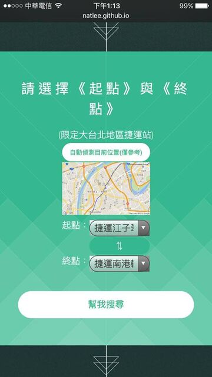
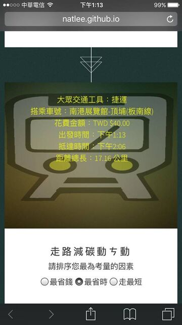
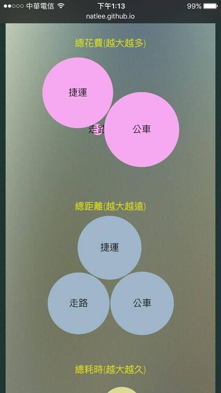

# 2016 資拓宏宇（IISI）黑客松：大台北 LOVE 即時運輸比較系統

> 這份文件整理自 2016 年參賽時的簡報《大台北LOVE.pptx》。原本的簡報檔（4.4 MB）在 2026 年重寫時從 repo 移除，內容和圖片保留在這裡；想看原檔可以從 git 歷史取回（commit `e641db7`）。

**第三隊**：GitHub 上的成員是 [@impaulapple](https://github.com/impaulapple)（寫了大部分的程式）和 [@NatLee](https://github.com/NatLee)。

> 今天解決不了的事 別急 明天也解決不了
> 你媽知道你在這邊參加超狂的黑客松嗎

## 5W1H

| | |
|---|---|
| What | 即時解決上班的路程規畫 |
| Why | 藍領階級的消費族群佔社會大眾的大多數 |
| Where | 大台北地區捷運 |
| When | Any time! |
| Who | 上班族 |
| How | 能存取網頁的裝置即可使用 |

（以上照簡報原文）步行與大眾運輸代替汽機車使用，可依照個人需求選擇如何抵達目的地。

## 技術

客製化 logo、HTML5、JavaScript 和 jQuery、CSS、Google Maps API、D3.js。

## 資料

- 交通部公共運輸整合資訊流通服務平台（PTX，現在的 TDX）
- 交通路網數值圖服務網
- Google Maps
- HTML5 UP 網頁模板
- D3.js

## 特點

快速、簡單、視覺化。

## 當年的畫面（簡報裡的 iPhone 截圖）

| 首頁 | 選起點和終點 | 比較結果 | 泡泡比一比 |
|---|---|---|---|
|  |  |  |  |

Demo 網址原本是 `natlee.github.io/2016IISI-HACKATHON/`，repo 改名後已經失效。

## 2016 → 2026：功能對照

2026 年重寫時，原本的每個功能都保留下來，資料來源從 Google Directions 換成政府開放資料。

| 2016 年 | 2026 年 |
|---|---|
| 起點、終點下拉選單（只有捷運站，依路線分組） | 搜尋捷運站、公車站、YouBike 站，或直接點地圖 |
| ⇅ 起訖對調 | 起訖對調按鈕 |
| 自動定位，選最近的捷運站 | 定位後以目前位置當起點，並顯示最近的捷運站和距離 |
| Google 地圖顯示目前位置 | MapLibre 暗色霓虹地圖，畫出捷運路線、站點、公車站和 YouBike |
| 點圖選站（測試中，另開路網圖） | 點地圖上的站或任一點，設成起點或終點 |
| 幫我比一比：步行、公車、捷運的車號、票價、出發抵達時間、距離、卡路里 | 比較步行、公車、捷運、捷運加公車、YouBike：路線、等車、抵達時間、距離、票價、熱量（同樣以 60 公斤計） |
| 泡泡比一比（D3 泡泡圖） | 泡泡比一比：耗時、距離、花費三組泡泡 |
| 走路減碳動ㄘ動：最省錢、最省時、走最短 | 同樣三種排序，第一名標「推薦」 |
| 公車站牌查詢（PTX，未完成） | 附近的公車站和每條路線的即時到站時間 |
| 手機版、回到頂端 | 手機版底部面板；單一畫面不需要捲回頂端 |
